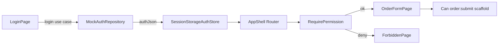

# React Router + User Auth/Permissions Implementation Plan

> **For agentic workers:** REQUIRED SUB-SKILL: Use superpowers:subagent-driven-development (recommended) or superpowers:executing-plans to implement this plan task-by-task. Steps use checkbox (`- [ ]`) syntax for tracking.

**Goal:** Add login → persist `authJson` → route-guarded app shell, with a `user` domain BC and a reusable permission scaffold for buttons/fields (route permissions fully enforced; field/button only framework + one demo usage).

**Architecture:** New `user` bounded context owns pure permission rules. Application ports load/save session and login. Presentation mounts `BrowserRouter`, hydrates session from `sessionStorage` before protected routes, and gates routes via `RequirePermission`. Button/field gating is a thin `Can` / `hasPermission` API — order form fields stay as today except one scaffold demo on Submit.

**Tech Stack:** React 19, Vite, TypeScript, Vitest, `react-router` (v7 Data mode / `BrowserRouter` + `Routes`).

**Also save full plan copy to:** [docs/superpowers/plans/2026-10-10-react-router-user-auth.md](docs/superpowers/plans/2026-10-10-react-router-user-auth.md) when executing (Plan mode creates this Cursor plan first).

## Global Constraints

- Follow [demo/agent.md](demo/agent.md) layering: Domain pure; no React/fetch in `domain/`
- Persist session as `authJson` string in `sessionStorage` key `dddfe.authJson`
- Route permissions are **required** and enforced before rendering protected pages
- Button/field permissions: ship **framework only** (`hasPermission` + `<Can>`) plus **one** demo gate on order Submit; do not wire every field
- Mock auth only — no real backend / OAuth
- All field edits on order form still go through `orchestrator.changeField`
- Package manager: `pnpm` under `demo/`
- No Redux / XState

## Locked product decisions

| Topic | Choice |
|-------|--------|
| Auth UX | Login page first; pick mock user → receive `authJson` → save → enter app |
| Storage | `sessionStorage` (`dddfe.authJson`) |
| Route perms | Enforced (`RequireAuth` + `RequirePermission`) |
| Button/field | Scaffold API + demo on Submit button only |
| Mock users | `viewer` (`order:view`), `editor` (`order:view`, `order:edit`, `order:submit`), `admin` (all incl. `admin:panel`) |

## Routes

| Path | Auth | Permission | Page |
|------|------|------------|------|
| `/login` | public | — | LoginPage |
| `/` | redirect → `/orders/order-1` | — | — |
| `/orders/:orderId` | required | `order:view` | OrderFormPage |
| `/admin` | required | `admin:panel` | simple AdminPage stub |
| `/forbidden` | required session (or public) | — | ForbiddenPage |



## File map

**Create**
- `demo/src/domain/user/model.ts` — `Permission`, `AuthSession`, `parseAuthJson`, `createAuthSession`
- `demo/src/domain/user/permissions.ts` — `hasPermission`, `hasAllPermissions`, `canAccessRoute`
- `demo/src/domain/user/index.ts` — barrel
- `demo/src/domain/user/permissions.test.ts`
- `demo/src/application/ports/AuthRepository.ts`
- `demo/src/application/ports/AuthSessionStore.ts`
- `demo/src/application/use-cases/login.ts`
- `demo/src/application/use-cases/logout.ts`
- `demo/src/application/use-cases/loadSession.ts`
- `demo/src/infrastructure/auth/mockUsers.ts` — mock credentials → authJson
- `demo/src/infrastructure/auth/MockAuthRepository.ts`
- `demo/src/infrastructure/auth/SessionStorageAuthStore.ts`
- `demo/src/presentation/auth/AuthContext.tsx` — session state + login/logout
- `demo/src/presentation/auth/createAuthDeps.ts`
- `demo/src/presentation/components/RequireAuth.tsx`
- `demo/src/presentation/components/RequirePermission.tsx`
- `demo/src/presentation/components/Can.tsx` — button/field scaffold
- `demo/src/presentation/pages/login/LoginPage.tsx`
- `demo/src/presentation/pages/forbidden/ForbiddenPage.tsx`
- `demo/src/presentation/pages/admin/AdminPage.tsx`
- `demo/src/presentation/router.tsx` — route table

**Modify**
- [demo/package.json](demo/package.json) — add `react-router`
- [demo/src/main.tsx](demo/src/main.tsx) — wrap `BrowserRouter` + `AuthProvider` if needed
- [demo/src/App.tsx](demo/src/App.tsx) — render router instead of bare `OrderFormPage`
- [demo/src/presentation/pages/order/index.tsx](demo/src/presentation/pages/order/index.tsx) — read `:orderId`; wrap Submit with `<Can permission="order:submit">`
- [demo/src/presentation/pages/order/components/SaveBar.tsx](demo/src/presentation/pages/order/components/SaveBar.tsx) — accept optional `submitAllowed` or render children via parent `Can`
- [demo/agent.md](demo/agent.md) — document user BC + routing/auth briefly

## AuthJson shape ( Domainsource of truth )

```ts
// authJson string parses to:
type AuthJson = {
  userId: string
  displayName: string
  roles: string[]
  permissions: string[] // e.g. "order:view", "order:edit", "order:submit", "admin:panel"
  issuedAt: number
}
```

Domain maps this to `AuthSession`. Presentation never invents permission rules ad hoc.

## Permission codes (initial set)

- Route: `order:view`, `admin:panel`
- Scaffold (defined + usable via `Can`, not deeply wired): `order:edit`, `order:submit`, `order:field:payType` (reserved string for future field gates)

---

### Task 1: Add react-router dependency

**Files:**
- Modify: `demo/package.json`, `demo/pnpm-lock.yaml`

- [ ] **Step 1:** In `demo/`, run `pnpm add react-router`
- [ ] **Step 2:** Confirm `package.json` lists `react-router` (v7.x)
- [ ] **Step 3:** Commit `chore: add react-router`

---

### Task 2: User domain — model + permission helpers (TDD)

**Files:**
- Create: `demo/src/domain/user/model.ts`, `permissions.ts`, `index.ts`, `permissions.test.ts`

**Interfaces:**
- Produces: `Permission` (string brand or alias), `AuthSession`, `parseAuthJson(json: string): AuthSession | null`, `hasPermission(session, code)`, `canAccessRoute(session, required: Permission | Permission[])`

- [ ] **Step 1: Write failing tests** in `permissions.test.ts`:

```ts
import { describe, expect, it } from 'vitest'
import { parseAuthJson, type AuthSession } from './model'
import { canAccessRoute, hasPermission } from './permissions'

const editor: AuthSession = {
  userId: 'u-editor',
  displayName: 'Editor',
  roles: ['editor'],
  permissions: ['order:view', 'order:edit', 'order:submit'],
  issuedAt: 1,
}

describe('parseAuthJson', () => {
  it('parses valid authJson', () => {
    const s = parseAuthJson(JSON.stringify(editor))
    expect(s?.userId).toBe('u-editor')
    expect(s?.permissions).toContain('order:view')
  })
  it('returns null for invalid json', () => {
    expect(parseAuthJson('{')).toBeNull()
  })
  it('returns null when permissions missing', () => {
    expect(parseAuthJson(JSON.stringify({ userId: 'x' }))).toBeNull()
  })
})

describe('hasPermission / canAccessRoute', () => {
  it('allows when permission present', () => {
    expect(hasPermission(editor, 'order:submit')).toBe(true)
  })
  it('denies when missing', () => {
    expect(hasPermission(editor, 'admin:panel')).toBe(false)
  })
  it('canAccessRoute requires all listed perms', () => {
    expect(canAccessRoute(editor, 'order:view')).toBe(true)
    expect(canAccessRoute(editor, ['order:view', 'admin:panel'])).toBe(false)
  })
})
```

- [ ] **Step 2:** `pnpm test` — expect FAIL (modules missing)
- [ ] **Step 3: Implement** `model.ts` + `permissions.ts` + barrel `index.ts` (minimal validation: require `userId`, `displayName`, `permissions: string[]`)
- [ ] **Step 4:** `pnpm test` — PASS
- [ ] **Step 5:** Commit `feat(user): add auth session model and permission checks`

---

### Task 3: Auth ports + use cases + mock infra

**Files:**
- Create ports, use cases, `mockUsers.ts`, `MockAuthRepository.ts`, `SessionStorageAuthStore.ts`

**Interfaces:**
- Consumes: `parseAuthJson`, `AuthSession`
- Produces:

```ts
// AuthRepository
login(username: string, signal?: AbortSignal): Promise<string> // authJson

// AuthSessionStore
load(): string | null
save(authJson: string): void
clear(): void

// use cases
createLogin({ authRepo, sessionStore }) => async (username) => AuthSession
createLogout({ sessionStore }) => () => void
createLoadSession({ sessionStore }) => () => AuthSession | null
```

- [ ] **Step 1:** Implement ports + `mockUsers` map:

```ts
// usernames: viewer | editor | admin
// each returns JSON.stringify({ userId, displayName, roles, permissions, issuedAt })
```

- [ ] **Step 2:** `MockAuthRepository.login` — delay ~200ms via existing `delay`; throw if unknown user
- [ ] **Step 3:** `SessionStorageAuthStore` — key `dddfe.authJson`
- [ ] **Step 4:** Use cases call Domain `parseAuthJson` after login/load; login saves raw authJson then returns session
- [ ] **Step 5:** Commit `feat(auth): add login ports, mock repo, sessionStorage store`

---

### Task 4: AuthContext + createAuthDeps

**Files:**
- Create: `demo/src/presentation/auth/createAuthDeps.ts`, `AuthContext.tsx`

**Interfaces:**
- Produces React context: `{ session, status: 'booting'|'anon'|'authed', login(username), logout() }`
- On mount: `loadSession()` from store → set session

- [ ] **Step 1:** `createAuthDeps` wires MockAuthRepository + SessionStorageAuthStore + use cases
- [ ] **Step 2:** `AuthProvider` boots from `loadSession`; `login` calls use case then `setSession`; `logout` clears store + session
- [ ] **Step 3:** Export `useAuth()` that throws if outside provider
- [ ] **Step 4:** Commit `feat(auth): add AuthProvider hydrating sessionStorage`

---

### Task 5: Route guards + Can scaffold + pages

**Files:**
- Create: `RequireAuth.tsx`, `RequirePermission.tsx`, `Can.tsx`, Login/Forbidden/Admin pages, `router.tsx`
- Modify: `App.tsx`, `main.tsx`, order page + SaveBar

**Guard behavior:**
- `RequireAuth`: if `booting` → loading; if `anon` → `<Navigate to="/login" replace state={{ from }} />`; else `<Outlet />`
- `RequirePermission permission="order:view"`: if `!canAccessRoute(session, permission)` → `<Navigate to="/forbidden" replace />`
- `Can`: if `hasPermission(session, permission)` render `children`, else `fallback` (default `null`)

- [ ] **Step 1:** Implement LoginPage — three buttons (viewer/editor/admin) calling `login(username)`; on success `navigate(from ?? '/')`
- [ ] **Step 2:** ForbiddenPage — message + link home/logout
- [ ] **Step 3:** AdminPage stub — “Admin panel”
- [ ] **Step 4:** `router.tsx` route tree as table above; wrap protected tree in `RequireAuth`
- [ ] **Step 5:** Wire `main.tsx`: `BrowserRouter` → `AuthProvider` → `App` → `<AppRouter />`
- [ ] **Step 6:** Order page: `useParams().orderId` (display in header; hydrate still uses mock id if repo ignores — pass through if `loadOrder` already takes id; wire `orchestrator.hydrate(orderId)` if needed with minimal change)
- [ ] **Step 7:** Scaffold demo — wrap Submit control with `<Can permission="order:submit" fallback={<button disabled>无提交权限</button>}>`
- [ ] **Step 8:** Manual check matrix:
  - viewer: can open order, Submit disabled/hidden via Can, `/admin` → forbidden
  - editor: order + submit ok, `/admin` → forbidden
  - admin: order + `/admin` ok
  - cold load `/orders/order-1` → redirect login → after login return to that path
- [ ] **Step 9:** `pnpm test` + `pnpm build` PASS
- [ ] **Step 10:** Update `agent.md` with user BC + router/auth notes
- [ ] **Step 11:** Commit `feat: route guards, login authJson session, Can permission scaffold`

---

## Spec coverage checklist

- Login before app entry + save authJson → Task 3–5
- Route permission enforcement → Task 5
- Button/field permission 框框 → Task 2 (`hasPermission`) + Task 5 (`Can` + Submit demo)
- DDD layering / user BC layout → Task 2–3, agent.md
- Order form existing behavior preserved → Task 5 only wraps Submit; no Domain order changes

## Out of scope

- Real JWT/OAuth, refresh tokens
- Per-field Domain enforcement of permissions
- i18n / design-system polish
- XState auth machine
