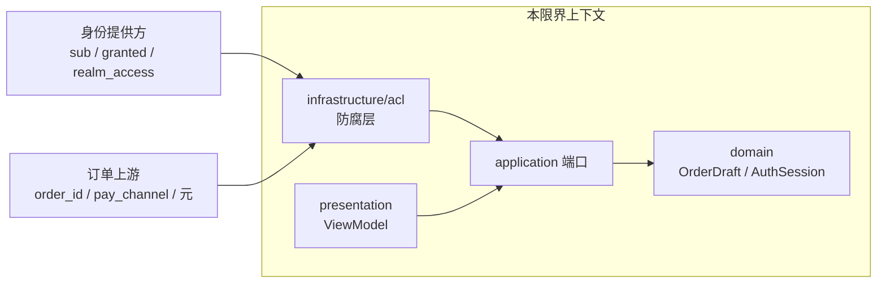
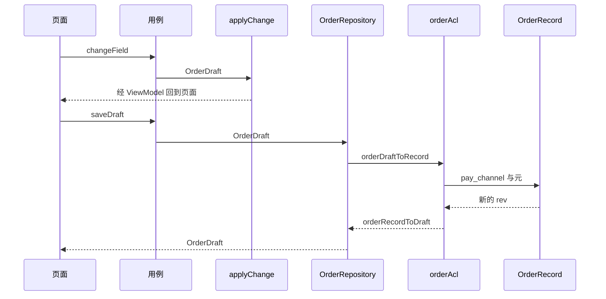
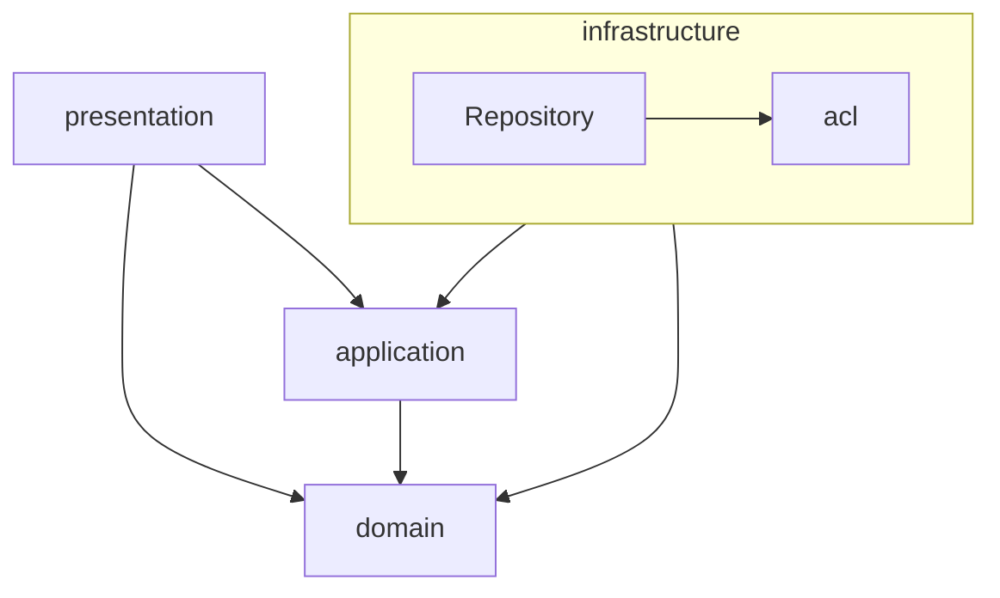
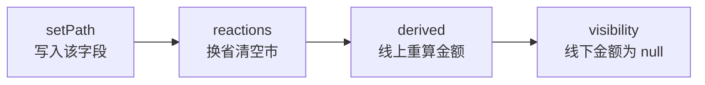

# 词表、防腐层与图

订单 demo 的通用语言、上游模型翻译，以及它们在分层里的位置。代码在 `src/infrastructure/acl/`。

端口仍然说本上下文的语言。`OrderRepository` 收发 `OrderDraft`。`AuthRepository.login` 返回本上下文的 `authJson`。上游字段名只出现在防腐层和 mock 夹具里。

## 词表

### 分层

| 词 | 英文 | 在本仓库里 |
| --- | --- | --- |
| 限界上下文 | Bounded Context | 一个 demo 应用。订单草稿和登录会话是这里的模型，不是上游的模型 |
| 通用语言 / 词表 | Ubiquitous Language | 本表。代码里的类型名和字段名跟这张表对齐 |
| 领域层 | Domain | `src/domain/<bc>/`。纯规则，无网络、无队列、无 UI |
| 应用层 | Application | `src/application/`。用例编排时机，只依赖端口 |
| 端口 | Port | `src/application/ports/`。仓储与查询的接口，类型用领域词 |
| 基础设施 | Infrastructure | `src/infrastructure/`。队列、mock、防腐层 |
| 防腐层 | Anti-Corruption Layer | `src/infrastructure/acl/`。上游模型 ↔ 领域模型 |
| 表示层 | Presentation | 页面、orchestrator、ViewModel |
| 视图模型 | ViewModel | `buildViewModel` 的投影。给 UI 看，不是上游 DTO，也不是防腐层 |
| 用例 | Use Case | `loadOrder`、`changeField`、`saveDraft`、`login` |
| 仓储 | Repository | 按端口取出或保存聚合数据。实现里先翻译再碰存储 |

### 订单

`OrderDraft` 是正在编辑的一张订单草稿，不是独立的子实体列表。

| 词 | 字段 | 含义 |
| --- | --- | --- |
| 订单草稿 | `OrderDraft` | 一次编辑中的订单 |
| 标识 | `id` | 草稿标识，如 `order-1` |
| 版本 | `version` | 本上下文的乐观锁。保存时与预期版本比对 |
| 支付方式 | `payType` | `online` 线上，`offline` 线下 |
| 数量 | `qty` | 件数，至少为 1 才能提交 |
| 单价 | `unitPrice` | 分 |
| 金额 | `amount` | 分。线上为数量 × 单价；线下隐藏且为 `null` |
| 省 / 市 | `province` / `city` | 地址。换省会清空市 |
| 字段写入 | `setPath` | 只改被点到的那个字段 |
| 联动 | `reactions` | 换省清空市 |
| 派生 | `derived` | 线上重算金额 |
| 显隐 | `visibility` | 线下把金额打成 `null` |
| 收敛 | `applyChange` | 唯一写入入口：`setPath` → `reactions` → `derived` → `visibility` |
| 可提交 | `canSubmit` | 数量、省市、线上金额都满足 |

### 用户

| 词 | 字段 | 含义 |
| --- | --- | --- |
| 会话 | `AuthSession` | 已翻译进本上下文的登录结果 |
| 用户标识 | `userId` | 本上下文里的用户 id |
| 显示名 | `displayName` | 页头上的名字 |
| 角色 | `roles` | `viewer` / `editor` / `admin` |
| 权限 | `permissions` | `order:view`、`order:edit`、`order:submit`、`order:field:payType`、`admin:panel` |
| 签发时间 | `issuedAt` | 毫秒时间戳 |
| 会话文档 | `authJson` | 上面这些字段的 JSON，存在 `sessionStorage` 键 `dddfe.authJson` |
| 解析会话 | `parseAuthJson` | 领域函数。只认识会话文档，不认识 IdP 字段 |

`parseAuthJson` 留在领域层，是因为它校验的是本上下文自己的会话文档。身份提供方的字段在进这扇门之前已经被防腐层换掉。

### 上游词（不得进入 Domain）

| 上游 | 本上下文 | 翻译 |
| --- | --- | --- |
| `order_id` | `id` | 原样 |
| `rev` | `version` | 原样 |
| `pay_channel: CARD` | `payType: online` | 枚举对换 |
| `pay_channel: CASH` | `payType: offline` | 枚举对换，金额改为 `null` |
| `line_qty` | `qty` | 非负整数 |
| `unit_price_yuan` | `unitPrice` | 元字符串 × 100 → 分 |
| `line_amount_yuan` | `amount` | 同上。现金单不保留上游的柜台合计 |
| `province_name` / `city_name` | `province` / `city` | 原样 |
| `sub` | `userId` | 原样 |
| `preferred_name` | `displayName` | 原样 |
| `auth_time` | `issuedAt` | 原样 |
| `ROLE_VIEWER` / `ROLE_EDITOR` / `ROLE_ADMIN` | `viewer` / `editor` / `admin` | 未知角色丢掉 |
| `ORD_VIEW` 等 `granted` | `order:view` 等权限 | 未知授权丢掉 |

金额用十进制字符串，最多两位小数：`"1"`、`"1.2"`、`"1.50"`。三位小数直接拒绝，不四舍五入。

## 防腐层

防腐层是适配器里的翻译，不是新的业务规则层。

- 订单：`src/infrastructure/acl/orderAcl.ts`。`orderRecordToDraft` / `orderDraftToRecord`。
- 登录：`src/infrastructure/acl/authAcl.ts`。`idpPrincipalToSession` / `idpPrincipalToAuthJson`。
- `MockOrderRepository` 内存里存的是 `OrderRecord`。进出端口时才变成 `OrderDraft`。版本冲突看的是 `rev`。
- `MockAuthRepository` 先拿到 `IdpPrincipal`，再写成 `authJson`。登录页和 `sessionStorage` 看到的仍是 `displayName`、`userId`。

现金单即使上游带了 `line_amount_yuan`，进领域也是 `amount: null`。这是模型翻译：本上下文不记录线下柜台合计。线上金额以翻译后的分为准，防腐层不重算 `qty * unitPrice`。重算仍是 `applyDerived` 的事。

未知的 `pay_channel`、空的 `order_id`、非法元字符串、空的 `sub` 会抛错。未知的角色和授权代码被丢掉，避免把别的系统的词写进 `permissions`。

不要做的事：

- 不要在 `src/domain/` 里出现 `pay_channel`、`ORD_VIEW`、`unit_price_yuan`。
- 不要让页面或用例 import `src/infrastructure/acl/`。用例只见端口。
- 不要把 ViewModel 当成防腐层。ViewModel 是领域草稿加上 `phase`、`dirty`、报错之后的界面投影。
- 不要在防腐层里实现「换省清空市」或「线下隐藏金额」以外的进模型动作。显隐和派生留在 `applyChange`。

## 图

上下游和本上下文。实线是数据进来时的翻译方向。

改字段不经过防腐层。保存和加载才翻译。

依赖方向。防腐层只在基础设施内部被仓储调用。

一次字段编辑的收敛顺序：

